<p align="center">
  <picture>
    <source media="(prefers-color-scheme: dark)" srcset="frontend/assets/brand/axiom-dark.svg">
    
  </picture>
</p>

# AX-NEWS

The world's tech news in one calm place — and on every screen of the
building. AX-NEWS gathers 200+ sources, translates them into English,
sorts them by topic and shows them as micro news on the web and as
around-the-clock TV channels for lobbies and break rooms. Self-hosted:
FastAPI, PostgreSQL, a vanilla JavaScript front end, offline translation.

Live at **[ax-news.com](https://ax-news.com)** · TV at
**[ax-news.com/tv.html](https://ax-news.com/tv.html)** ·
Latest release: **[v1.3.0](https://github.com/plkarin/ax-news/releases/tag/v1.3.0)** ([changes](CHANGELOG.md))

<p align="center">
  <a href="docs/SCREENSHOTS.md">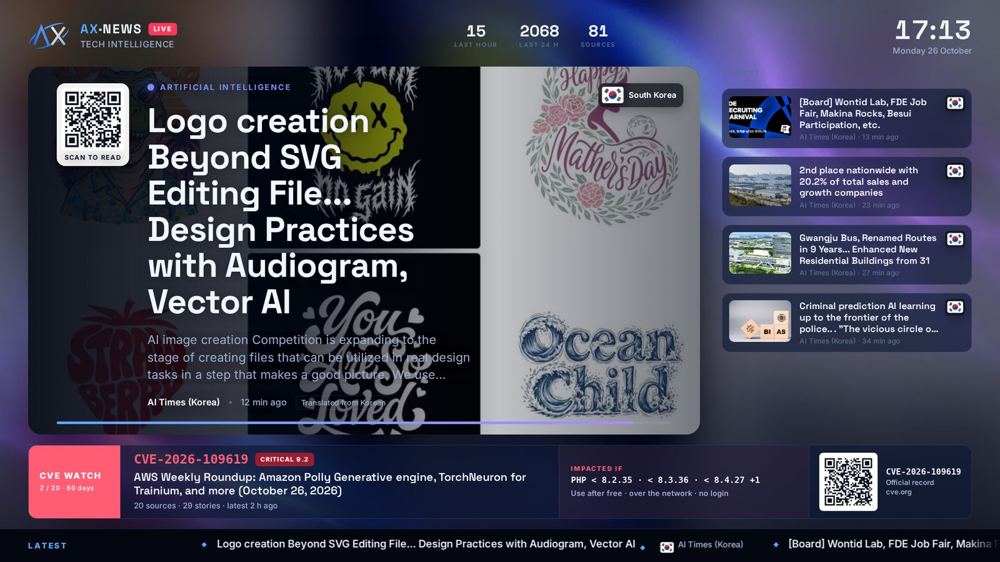</a>
</p>

---

## Contents

- [Screenshots](#screenshots)
- [Features](#features)
- [Releases](#releases)
- [Architecture](#architecture)
- [Installation](#installation)
- [Configuration](#configuration)
- [Operations](#operations)
- [Development](#development)
- [Licence](#licence)

## Screenshots

<table>
  <tr>
    <td width="50%" align="center">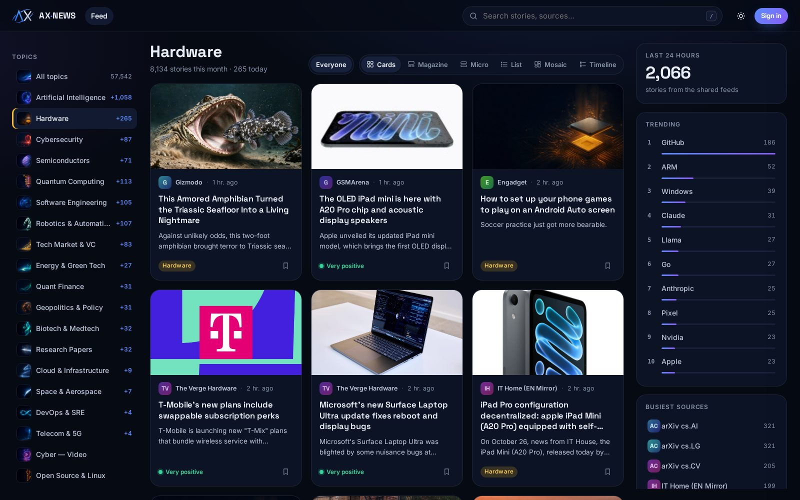<br><sub>The feed, cards layout</sub></td>
    <td width="50%" align="center">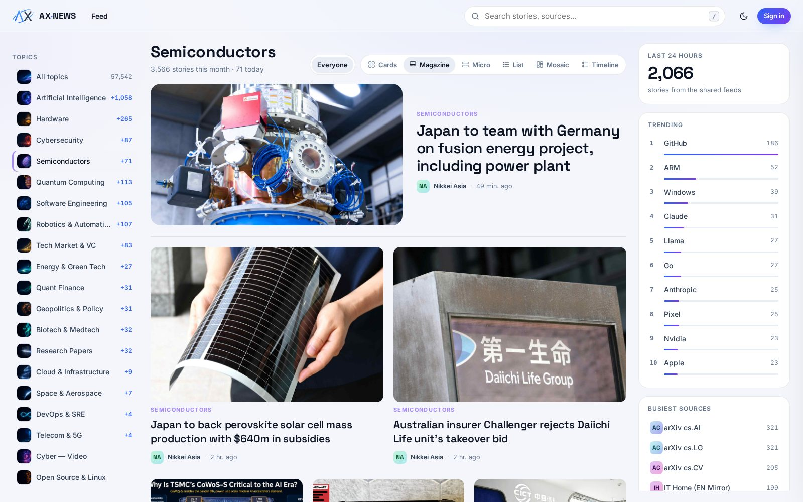<br><sub>Magazine layout, light theme</sub></td>
  </tr>
  <tr>
    <td width="50%" align="center">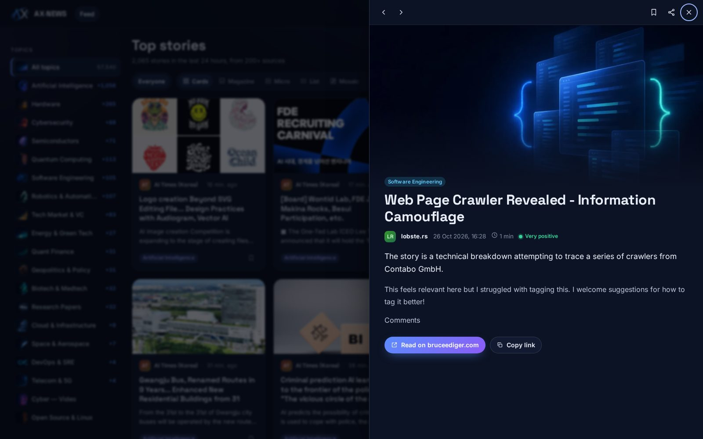<br><sub>The reader panel</sub></td>
    <td width="50%" align="center">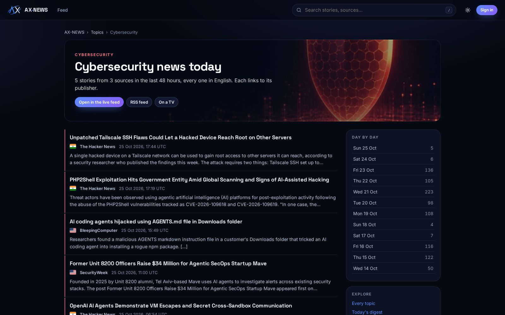<br><sub>A topic page, open to search engines</sub></td>
  </tr>
  <tr>
    <td width="50%" align="center">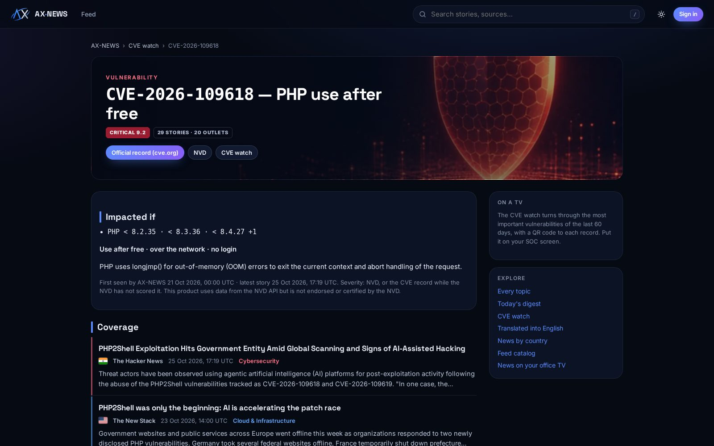<br><sub>A CVE page: Impacted if, severity, coverage</sub></td>
    <td width="50%" align="center">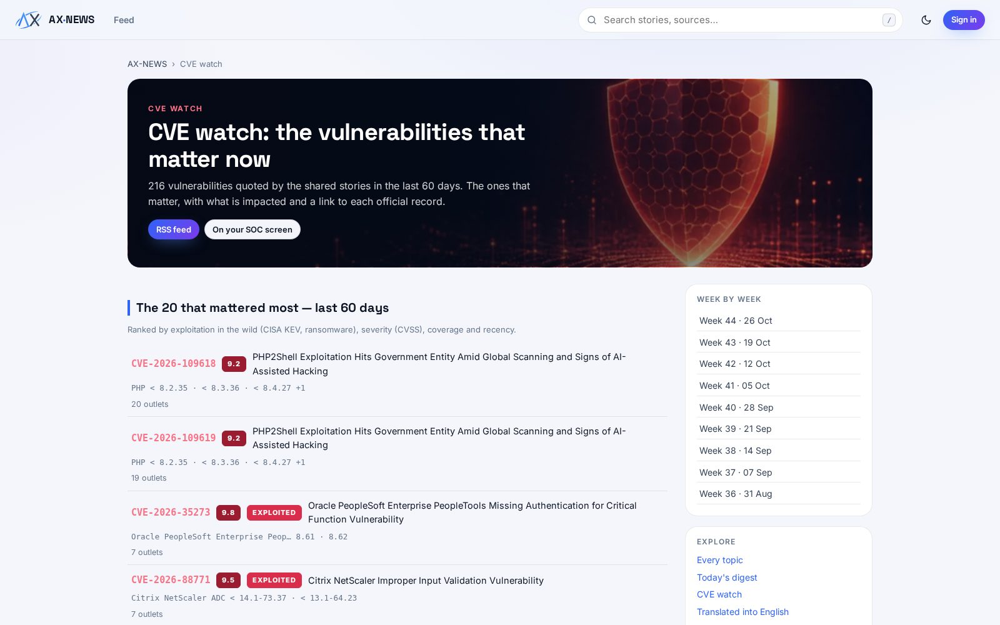<br><sub>The CVE watch</sub></td>
  </tr>
  <tr>
    <td width="50%" align="center">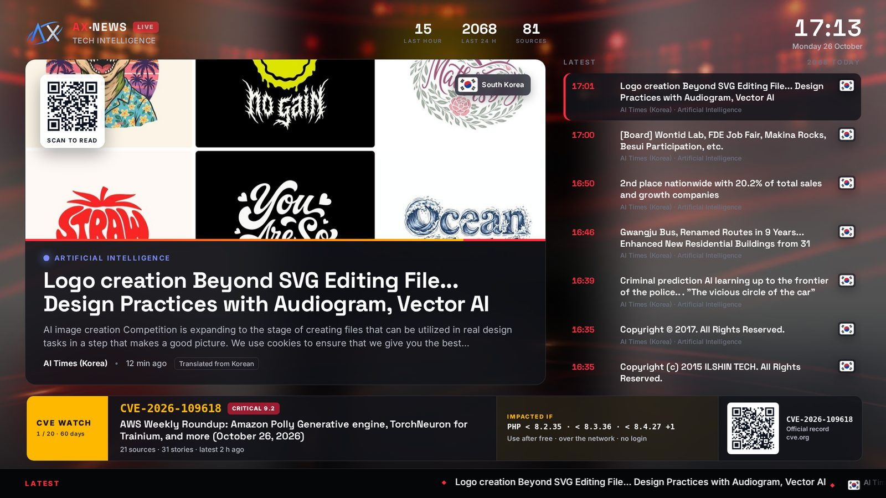<br><sub>TV — Newsroom layout, Broadcast theme</sub></td>
    <td width="50%" align="center">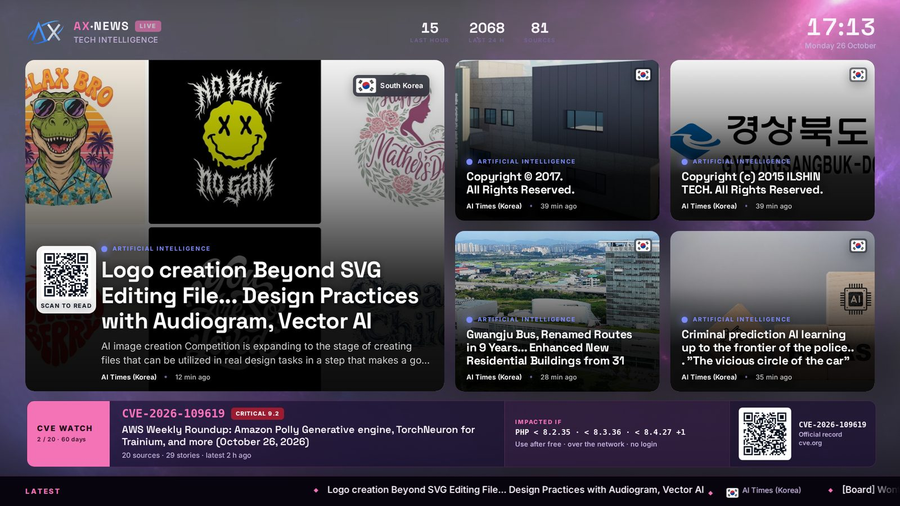<br><sub>TV — Wall layout, Nebula theme</sub></td>
  </tr>
  <tr>
    <td width="50%" align="center">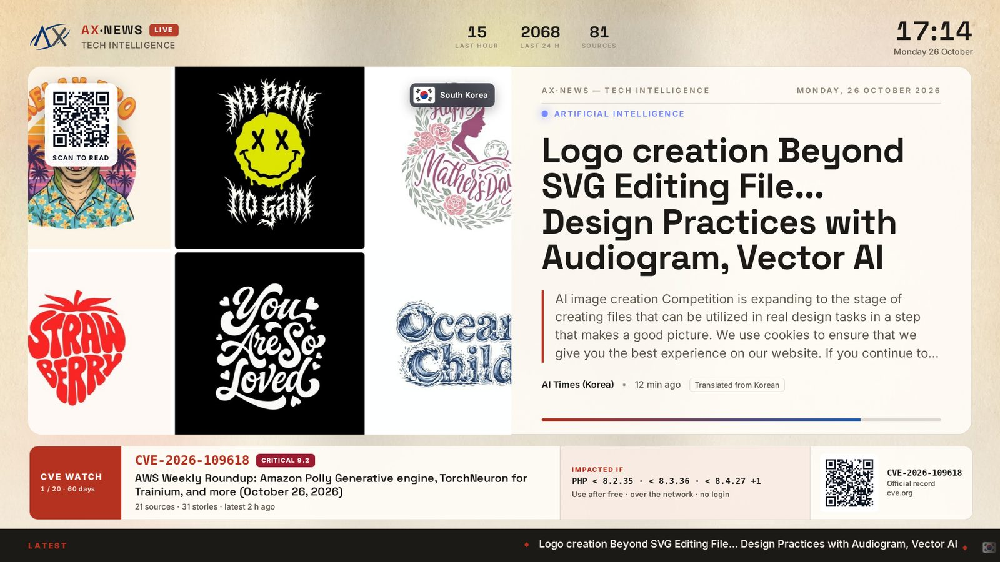<br><sub>TV — Magazine layout, Paper theme</sub></td>
    <td width="50%" align="center">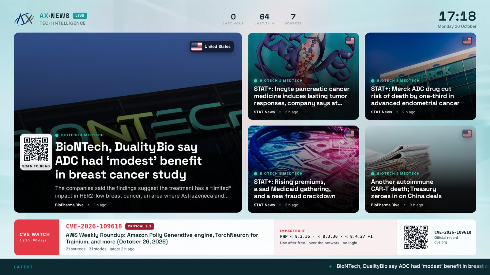<br><sub>TV — Wall layout, Clinic theme</sub></td>
  </tr>
  <tr>
    <td width="50%" align="center">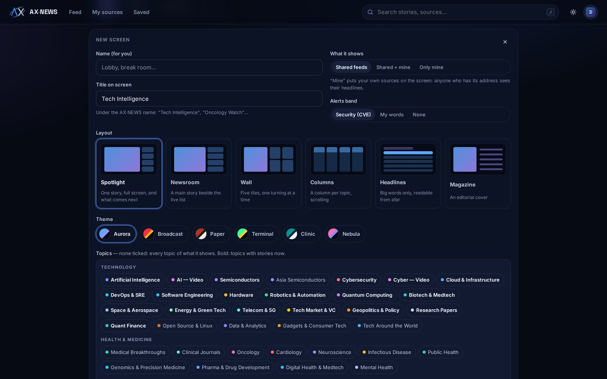<br><sub>Setting up a TV screen</sub></td>
    <td width="50%" align="center">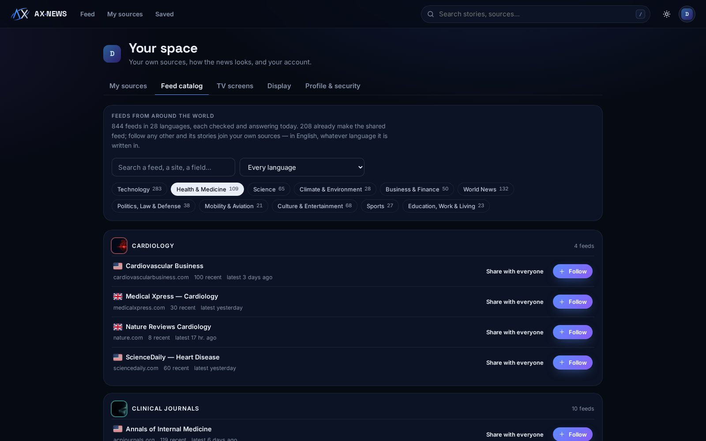<br><sub>The world feed catalog</sub></td>
  </tr>
</table>

Every screen — the six TV layouts, the sign-in page, the phone — is in
**[docs/SCREENSHOTS.md](docs/SCREENSHOTS.md)**.

## Features

### Reading
- **Six layouts** for the same news — cards, magazine, micro news, dense
  list, picture mosaic, hour-by-hour timeline — and a reader panel with
  keyboard navigation (`j`/`k`, `o`, `s`, `v`, `/`).
- Topics with illustrations for every story without a picture, search,
  saved stories, light and dark themes, per-account display preferences.
- Sentiment and entity extraction by a static model (no LLM cost), trending
  entities and busiest sources.

### Sources from everywhere
- **The shared feeds**: 208 technology feeds, fetched by a co-located
  FreshRSS every 15 minutes.
- **Your own sources**, private to your account: any site that announces a
  feed, RSS/Atom, YouTube channels, subreddits, Mastodon accounts, GitHub
  releases, Hacker News — found from a plain link; OPML import and export.
- **A world feed catalog** (`catalog/`): 844 feeds, each checked and
  answering, in 11 fields — technology, health & medicine, science, climate,
  business, world news by region, politics/law/defense, mobility, culture,
  sports, education/work — and 28 languages. Any account follows any of them
  in one click; an administrator can share one with everyone.

### English, whatever the language
- Every source in another language — known from the catalog or detected
  from its stories — is translated into English, title and first
  paragraphs, offline by [Argos Translate](https://github.com/argosopentech/argos-translate)
  (no API, no cost). A language without an installed model is flagged
  rather than shown untranslated.

### TV screens
- `/tv.html` shows the shared feeds; `/tv/<token>` shows a screen an
  account set up: its topics, the shared feeds and/or its own sources, its
  pace and alerts. Built for 75–90" screens, 1080p to 4K, landscape or
  portrait.
- **Six layouts** (spotlight, newsroom, wall, columns, headlines, magazine)
  × **six themes** (aurora, broadcast, paper, terminal, clinic, nebula).
- On every story: a **QR code** at its top left to read it on a phone, the
  **flag of the outlet's country** at its top right.
- **CVE watch**: a band that turns through the 20 vulnerabilities that
  mattered most in the last 60 days — exploited in the wild (CISA KEV,
  ransomware), severity (NVD CVSS), coverage, recency — each with an
  **Impacted if** summary (products and versions touched, kind of flaw, what
  an attacker needs) and a QR code to its official record on cve.org. A
  CVE seen for the first time with a score of 8 or more is **breaking news**
  for an hour: CRITICAL, in Spotlight's side column or in the band. Or a band of the screen's own words
  ("FDA approval", "phase 3"…).
- Made to run unattended for months: refresh every two minutes, the last
  news kept through network cuts, reload on a new version and every night,
  screen kept awake, cursor hidden, no burn-in, optional night dimming.
  Keys: `F` full screen, `L` layout, `T` theme, `Space` pause, `←`/`→`.

### Open to search engines and readers
- **Pages a search engine can read**, rendered on the server: every topic
  (`/topics`, `/topic/<topic>`) and every topic day
  (`/topic/<topic>/<date>`), a **daily digest** (`/digest/<date>`), a page
  per **CVE** (`/cve/<id>`: Impacted if, severity, CISA KEV, the stories
  that quote it) and per week (`/cve/week/<year>-W<nn>`), news **by country**
  (`/countries`, `/country/<cc>`), stories **translated into English**
  (`/translated`), the **feed catalog** by field with its OPML (`/feeds`,
  `/feeds/<field>`, `/feeds/<field>.opml`) and a page for **office TVs**
  (`/tv-screens`). The home page renders its first 30 stories too.
- **RSS** for every topic (`/topic/<topic>/feed.xml`) and for the CVE watch
  (`/cve/feed.xml`).
- Canonical addresses, titles and descriptions per page, structured data
  (JSON-LD: CollectionPage, ItemList, BreadcrumbList), a sitemap index
  (`/sitemap.xml` → pages, days, CVEs), `robots.txt`, `llms.txt`. Private
  pages (`/account`, `/tv/<token>`, `/go/…`) stay out of the index.
- `seo-worker.py` tells Bing, Yandex, Seznam and Naver which pages are new
  through **IndexNow**; `social-worker.py` posts each **breaking CVE** to
  Mastodon and/or Bluesky once their accounts are set.

### Accounts and security
- Administrator-approved accounts, Google sign-in, an admin console.
- Content Security Policy with a nonce per response on every page, an SSRF
  guard on every fetch of an outside address, rate limits, HttpOnly
  sessions; A+ on SSL Labs.

## Releases

AX-NEWS follows [semantic versioning](https://semver.org): `vMAJOR.MINOR.PATCH`.
Each release is a git tag and a GitHub release; [CHANGELOG.md](CHANGELOG.md)
lists what each one changes. Production runs a tagged release:

```bash
cd /opt/ax-news && git fetch --tags origin && git checkout v1.3.0
```

## Architecture

```
Internet → Cloudflare → HAProxy (TLS) → nginx ─┬─ frontend/ (CSS, JS, images, fonts)
                                               └─ FastAPI (uvicorn, 2 workers) → PostgreSQL 16
                                                     ↑
 FreshRSS (127.0.0.1:8082) ── sync every 10 min ─────┤
 sources-worker.py (own and shared sources) ─────────┤
 translate-standalone.py (Argos, MemoryMax=1G) ──────┘
 seo-worker.py → IndexNow · social-worker.py → Mastodon, Bluesky
```

| Piece | What it does |
|---|---|
| `backend/main.py` | API and pages (Jinja2 templates, per-request CSP nonce) |
| `backend/sources.py` | Feed discovery, the SSRF-guarded fetcher, storage of sources' stories |
| `backend/catalog.py` | Loads `catalog/feeds.json` at start-up; the topic taxonomy |
| `backend/translation.py` | Language of each story, translation into English |
| `backend/tv.py`, `backend/cve.py` | TV screens' stories; the CVE watch (CISA KEV + NVD) |
| `backend/countries.py` | Country of each outlet, for the TV's flags and the country pages |
| `backend/seo.py` | The pages for search engines: topics, digests, countries, CVEs, catalog; RSS, OPML, sitemaps, JSON-LD |
| `frontend/assets/` | The interface: `css/app.css`, `css/tv.css`, `js/*.js`, fonts, images |

nginx serves `frontend/` by file extension and sends every page (`/`,
`*.html`, `/tv/…`) and `/api/` to FastAPI. The `frontend/*.html` files are
symlinks to `backend/templates/`, which are the pages' source.

## Installation

Ubuntu 24.04 with PostgreSQL 16, Python 3.12, nginx and PHP 8.3 (for
FreshRSS). The units expect the checkout at `/opt/ax-news`, run as the
user `cbrain`.

```bash
sudo git clone https://github.com/plkarin/ax-news.git /opt/ax-news
sudo chown -R cbrain:cbrain /opt/ax-news && cd /opt/ax-news
git checkout v1.3.0
python3 -m venv backend/venv
backend/venv/bin/pip install -r backend/requirements.txt

cp backend/.env.example backend/.env          # then fill it in: see Configuration

# Database: an empty PostgreSQL database owned by the application user
psql "$DATABASE_URL" -f migrations/001_schema.sql
psql "$DATABASE_URL" -f migrations/003_personal_sources.sql
psql "$DATABASE_URL" -f migrations/004_catalog_tv.sql

# Translation models into English: about 2.5 GB for the 13 default languages, downloaded once
deploy/install-argos-models.sh

sudo mkdir -p /var/log/ax-news && sudo chown cbrain:cbrain /var/log/ax-news
sudo cp deploy/systemd/*.service deploy/systemd/*.timer /etc/systemd/system/
sudo cp deploy/nginx/ax-news /etc/nginx/sites-available/
sudo ln -s /etc/nginx/sites-available/ax-news /etc/nginx/sites-enabled/
sudo nginx -t && sudo systemctl reload nginx

sudo systemctl daemon-reload
sudo systemctl enable --now ax-news-backend
sudo systemctl enable --now ax-news-sync.timer ax-news-translate.timer \
  ax-news-images.timer ax-news-sources.timer

# FreshRSS and its 208 feeds
sudo FRESHRSS_USER=<user> FRESHRSS_PASS=<password> deploy/install-freshrss.sh
```

(`migrations/002_audio_columns.sql` belongs to the audio summaries, removed
before v1.0.0: a new database does not need it.)

## Configuration

`backend/.env` (template: `backend/.env.example`):

| Variable | Use |
|---|---|
| `DATABASE_URL` | PostgreSQL connection |
| `HOME` | Where the Argos models are installed (`/opt/ax-news/.argos-home`) |
| `FRESHRSS_BASE_URL`, `FRESHRSS_USER`, `FRESHRSS_API_PASS` | The FreshRSS API |
| `APP_URL` | Public address (links, QR codes, cookies' `Secure` flag) |
| `GOOGLE_CLIENT_ID`, `GOOGLE_CLIENT_SECRET` | Google sign-in |
| `SMTP_*` | Mail (address verification) |
| `INTERNAL_SYNC_TOKEN` | Sent by the timers from localhost to start work (sync, images, purge); `openssl rand -hex 32` |
| `TV_TOKEN` | Read-only token of the legacy `/api/tv/articles` feed; empty refuses it |
| `MAX_SOURCES_PER_USER` | Own sources per account (default 150) |
| `MASTODON_BASE_URL`, `MASTODON_TOKEN` | Account `social-worker.py` posts breaking CVEs to (token scope `write:statuses`); empty: no post |
| `BLUESKY_HANDLE`, `BLUESKY_APP_PASSWORD` | Same on Bluesky, with an app password; empty: no post |
| `AXNEWS_LOCAL_URL` | Where the workers reach the backend (default `http://127.0.0.1:8000`) |

## Operations

| Timer | Runs | Enabled by default |
|---|---|---|
| `ax-news-sync` | FreshRSS → database, every 10 min | yes |
| `ax-news-translate` | Translation, 8 min of work every 10 min | yes |
| `ax-news-sources` | Accounts' and shared catalog sources, every 5 min | yes |
| `ax-news-images` | Pictures for stories without one, hourly | yes |
| `freshrss-refresh` | FreshRSS fetches its feeds, every 15 min | yes |
| `ax-news-seo` | IndexNow: the sitemaps' new pages to Bing and others, hourly | no — enable once the site is verified |
| `ax-news-social` | Breaking CVEs to Mastodon/Bluesky, every 5 min | no — enable once an account is set |
| `ax-news-dedup` | Removes duplicate stories, hourly | no — enable once reviewed |
| `ax-news-purge` | Deletes stories older than 30 days, Mondays 03:00 | no — enable to keep a month |

**Update** to a release: `git fetch --tags origin && git checkout vX.Y.Z`,
then `backend/venv/bin/pip install -r backend/requirements.txt`, the new
`migrations/` files if any (they are additive), and
`sudo systemctl restart ax-news-backend`. Back up first:
`pg_dump -Fc "$DATABASE_URL" -f ax-news-$(date +%F).dump`.
**Roll back**: check out the previous tag and restart; migrations never
remove what an older release reads.

**Search engines**: declare `https://ax-news.com/sitemap.xml` in Google
Search Console and Bing Webmaster Tools. IndexNow needs no account: its key
is derived from `INTERNAL_SYNC_TOKEN` and served at `/<key>.txt`.

**More languages**: `deploy/install-argos-models.sh pl sv da nb fi cs el ro hu uk he fa hi id th`
installs the models the catalog's other languages need; their feeds then
become available.

## Development

```bash
cd backend && set -a && . ./.env && set +a
AXNEWS_SERVE_STATIC=1 venv/bin/uvicorn main:app --port 8001   # serves frontend/ too
```

- **Catalog**: `catalog/sources/*.txt` lists the feeds, one per line
  (`category | lang | region | title | feed url | site url`; `active.txt` is
  the FreshRSS subscription list). `backend/venv/bin/python -I tools/catalog/build.py`
  fetches every one, keeps those answering with a story from the last year,
  and writes `catalog/feeds.json`. `catalog/taxonomy.json` names the fields
  and topics (label, colour, illustration) for the site and the TV.
- **Brand**: `python3 -I tools/brand/build.py` draws the logo, the ΛX emblem,
  the favicons and the link preview from geometry (needs fontTools, Pillow,
  rsvg-convert).
- **Pages**: edit `backend/templates/`, never the `frontend/*.html` symlinks.

## Licence

The code of AX-NEWS is under the **MIT licence** — see [LICENSE](LICENSE).
Copyright © 2026 Pierre-Léonard Karin.

Not covered by the MIT licence:

| What | Where | Terms |
|---|---|---|
| The **AXIOM** and **AX-NEWS** names and logos | `frontend/assets/brand/`, `frontend/logo.*`, favicons | Not licensed: they identify this project. A fork uses its own. |
| Inter and Space Grotesk fonts | `frontend/assets/fonts/` | SIL Open Font License 1.1 — `frontend/assets/fonts/LICENSE.txt` |
| Country flags ([flag-icons](https://github.com/lipis/flag-icons) 7.5.0) | `frontend/assets/img/flags/` | MIT — `frontend/assets/img/flags/LICENSE.txt` |
| Topic illustrations, TV backgrounds and sign-in picture, made with Canva | `frontend/assets/img/topics/`, `frontend/assets/img/tv/`, `login-hero.webp` | [Canva's Content License](https://www.canva.com/policies/content-license-agreement/) |
| Screenshots | `docs/screenshots/`, `frontend/assets/img/screens/` | The interface is under the MIT licence like the code; the stories, titles and pictures they show belong to their publishers. |
| News: titles, excerpts, pictures | shown from the feeds | Their publishers'. AX-NEWS shows a story's title, a short excerpt and a link to the original. |

Data sources: vulnerability severities come from the National Vulnerability
Database — *this product uses data from the NVD API but is not endorsed or
certified by the NVD*. Known exploited vulnerabilities come from CISA's
[KEV catalog](https://www.cisa.gov/known-exploited-vulnerabilities-catalog).
CVE® is a registered trademark of The MITRE Corporation.

Python dependencies (`backend/requirements.txt`) and FreshRSS (AGPL-3.0,
installed separately by `deploy/install-freshrss.sh`) keep their own
licences.
