<p align="center">
  <picture>
    <source media="(prefers-color-scheme: dark)" srcset="frontend/assets/brand/axiom-dark.svg">
    
  </picture>
</p>

# AX-NEWS

The world's tech news in one calm place — and on every screen of the
building. AX-NEWS gathers 200+ sources, translates them into English,
sorts them by topic and shows them as micro news on the web and as
around-the-clock TV channels for lobbies and break rooms. Self-hosted:
FastAPI, PostgreSQL, a vanilla JavaScript front end, offline translation.

Live at **[ax-news.com](https://ax-news.com)** · TV at
**[ax-news.com/tv.html](https://ax-news.com/tv.html)** ·
Latest release: **[v1.4.1](https://github.com/plkarin/ax-news/releases/tag/v1.4.1)** ([changes](CHANGELOG.md)) ·
**[Install](#installation)** in one command

[](https://github.com/plkarin/ax-news/actions/workflows/ci.yml)

<p align="center">
  <a href="docs/SCREENSHOTS.md">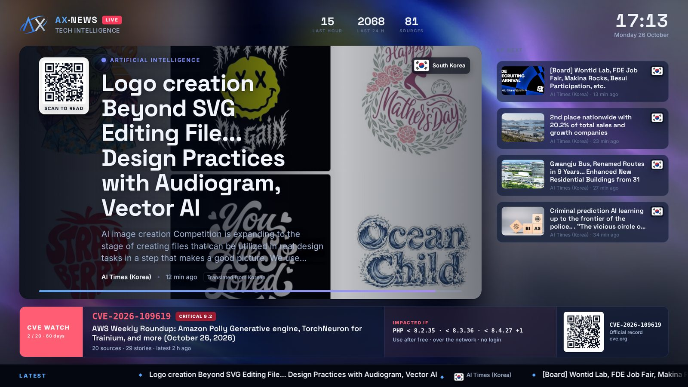</a>
</p>

---

## Contents

- [Screenshots](#screenshots)
- [Features](#features)
- [Installation](#installation)
- [Releases](#releases)
- [Architecture](#architecture)
- [Development](#development)
- [Licence](#licence)

## Screenshots

<table>
  <tr>
    <td width="50%" align="center">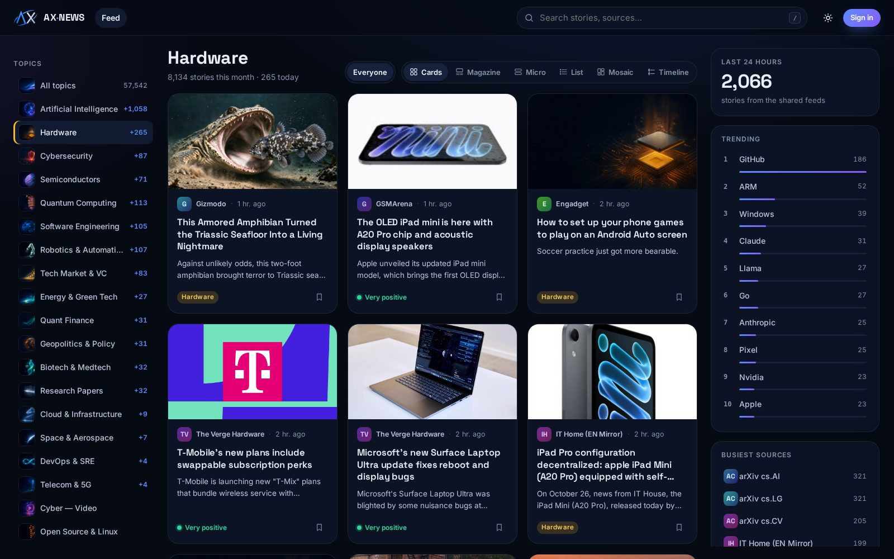<br><sub>The feed, cards layout</sub></td>
    <td width="50%" align="center">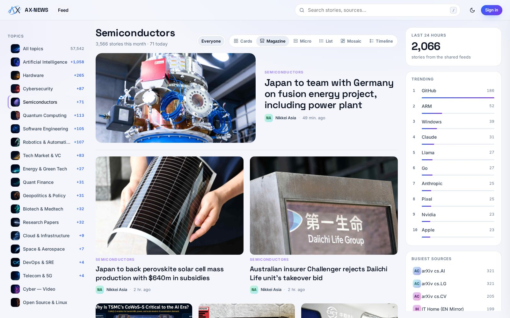<br><sub>Magazine layout, light theme</sub></td>
  </tr>
  <tr>
    <td width="50%" align="center">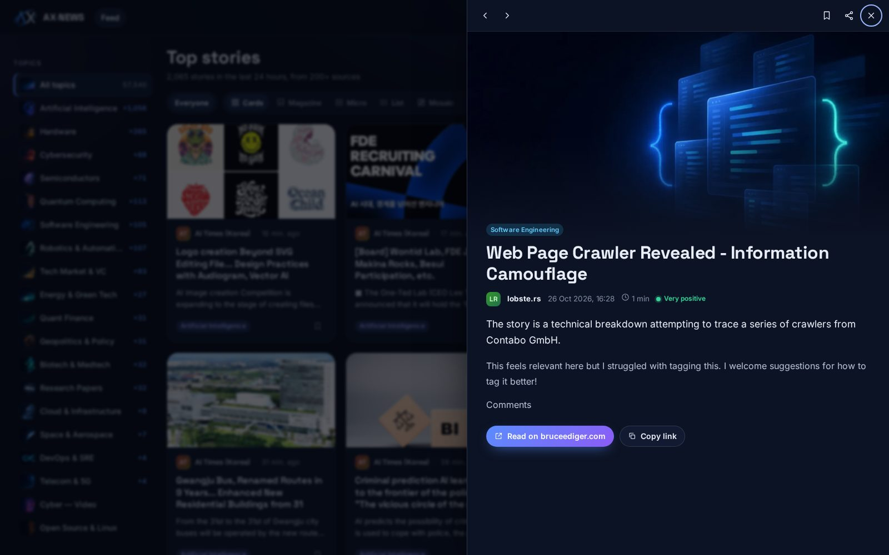<br><sub>The reader panel</sub></td>
    <td width="50%" align="center">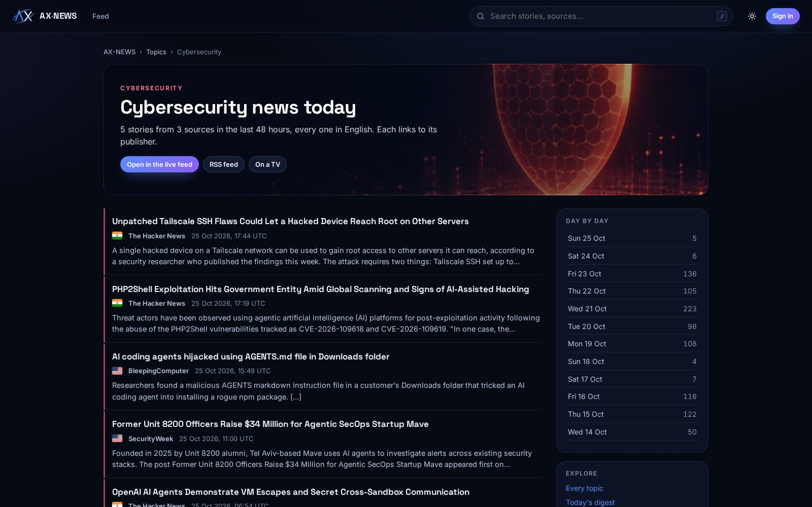<br><sub>A topic page, open to search engines</sub></td>
  </tr>
  <tr>
    <td width="50%" align="center">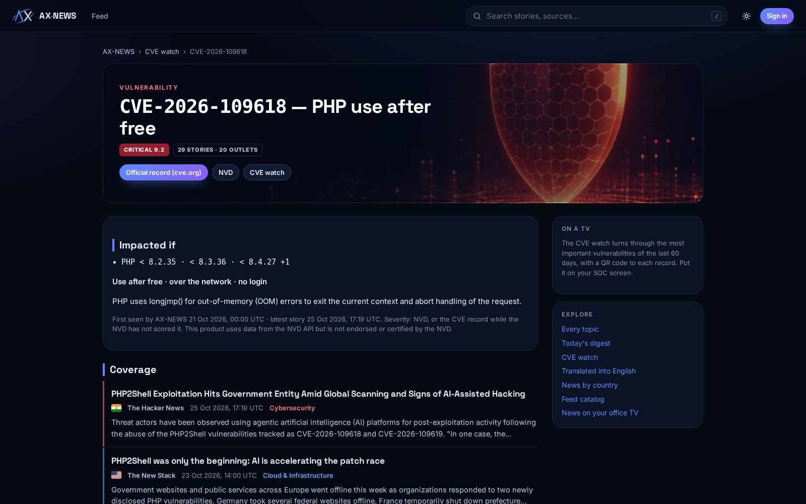<br><sub>A CVE page: Impacted if, severity, coverage</sub></td>
    <td width="50%" align="center">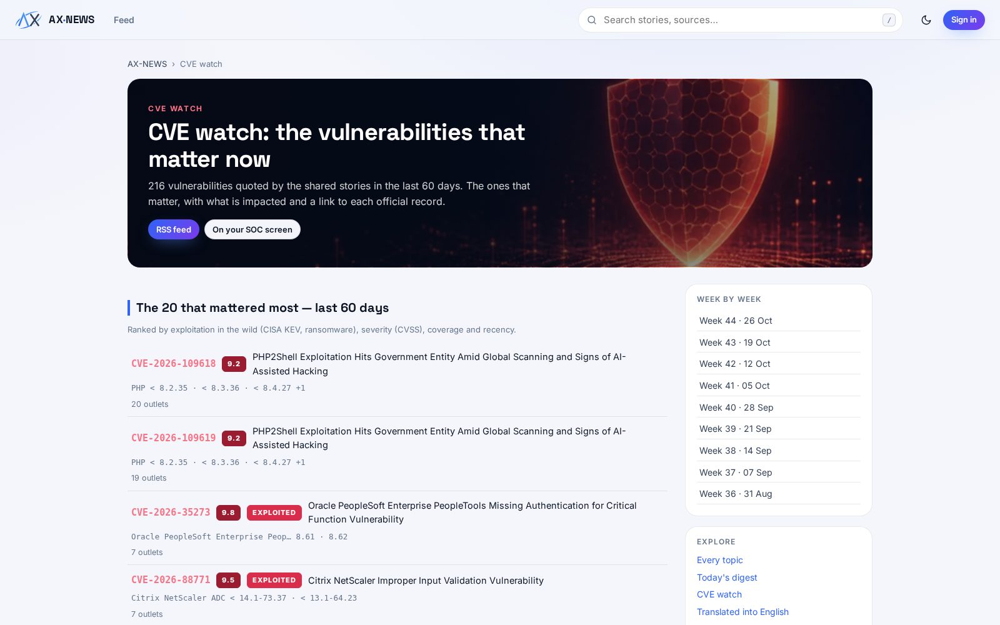<br><sub>The CVE watch</sub></td>
  </tr>
  <tr>
    <td width="50%" align="center">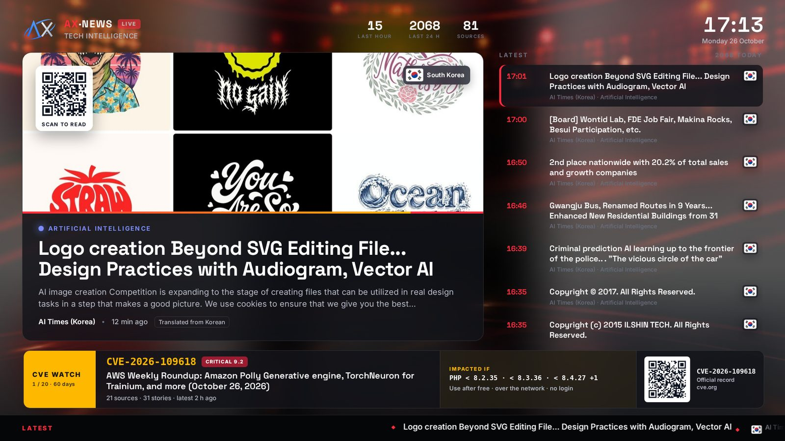<br><sub>TV — Newsroom layout, Broadcast theme</sub></td>
    <td width="50%" align="center">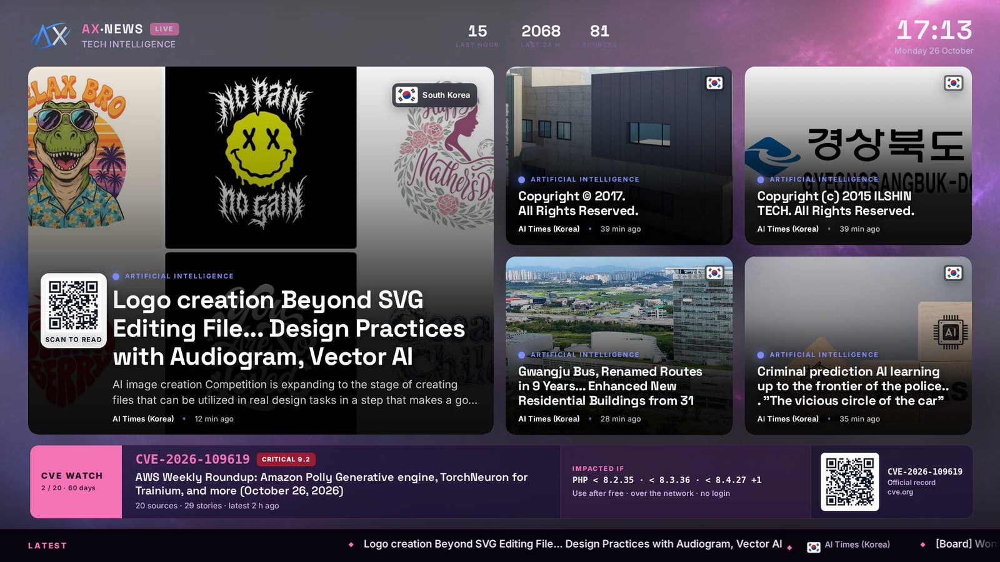<br><sub>TV — Wall layout, Nebula theme</sub></td>
  </tr>
  <tr>
    <td width="50%" align="center">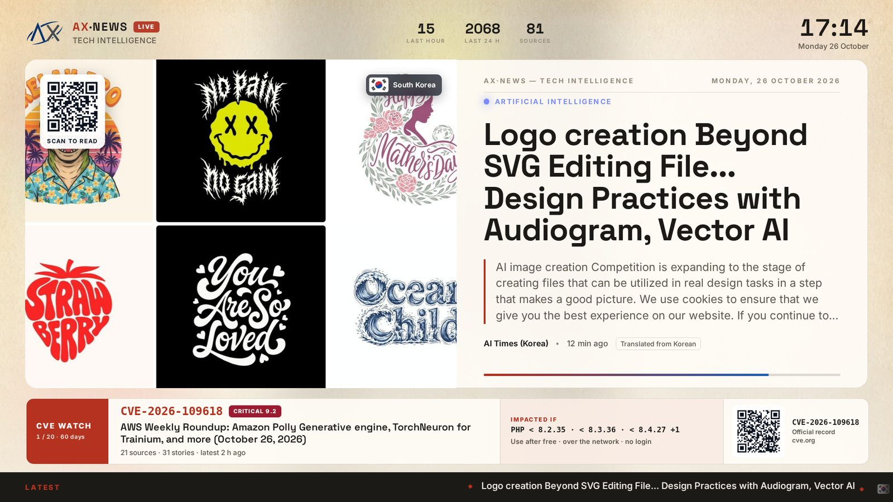<br><sub>TV — Magazine layout, Paper theme</sub></td>
    <td width="50%" align="center">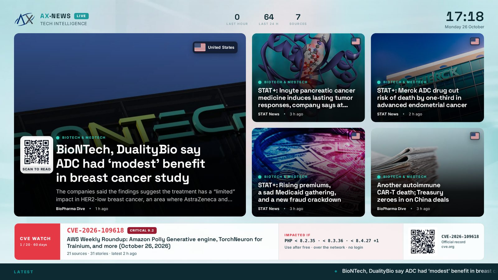<br><sub>TV — Wall layout, Clinic theme</sub></td>
  </tr>
  <tr>
    <td width="50%" align="center">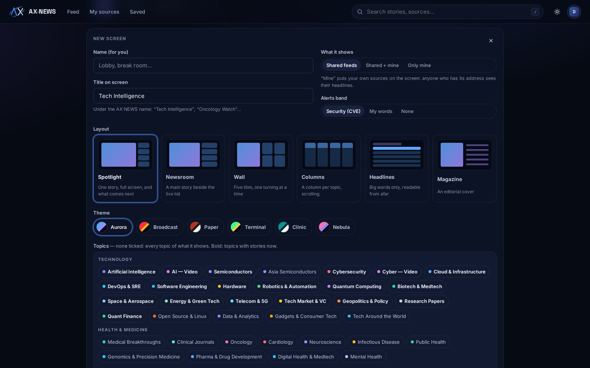<br><sub>Setting up a TV screen</sub></td>
    <td width="50%" align="center">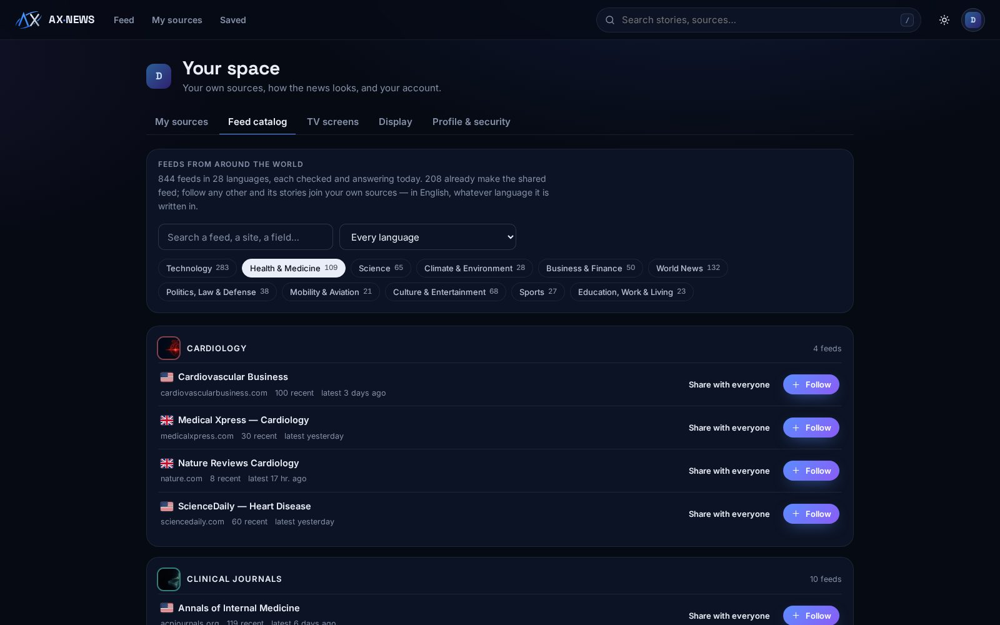<br><sub>The world feed catalog</sub></td>
  </tr>
</table>

Every screen — the six TV layouts, the sign-in page, the phone — is in
**[docs/SCREENSHOTS.md](docs/SCREENSHOTS.md)**.

## Features

### Reading
- **Six layouts** for the same news — cards, magazine, micro news, dense
  list, picture mosaic, hour-by-hour timeline — and a reader panel with
  keyboard navigation (`j`/`k`, `o`, `s`, `v`, `/`).
- Topics with illustrations for every story without a picture, search,
  saved stories, light and dark themes, per-account display preferences.
- Sentiment and entity extraction by a static model (no LLM cost), trending
  entities and busiest sources.

### Sources from everywhere
- **The shared feeds**: 208 technology feeds, fetched by a co-located
  FreshRSS every 15 minutes.
- **Your own sources**, private to your account: any site that announces a
  feed, RSS/Atom, YouTube channels, subreddits, Mastodon accounts, GitHub
  releases, Hacker News — found from a plain link; OPML import and export.
- **A world feed catalog** (`catalog/`): 844 feeds, each checked and
  answering, in 11 fields — technology, health & medicine, science, climate,
  business, world news by region, politics/law/defense, mobility, culture,
  sports, education/work — and 28 languages. Any account follows any of them
  in one click; an administrator can share one with everyone.

### English, whatever the language
- Every source in another language — known from the catalog or detected
  from its stories — is translated into English, title and first
  paragraphs, offline by [Argos Translate](https://github.com/argosopentech/argos-translate)
  (no API, no cost). A language without an installed model is flagged
  rather than shown untranslated.

### TV screens
- `/tv.html` shows the shared feeds; `/tv/<token>` shows a screen an
  account set up: its topics, the shared feeds and/or its own sources, its
  pace and alerts. Built for 75–90" screens, 1080p to 4K, landscape or
  portrait.
- **Six layouts** (spotlight, newsroom, wall, columns, headlines, magazine)
  × **six themes** (aurora, broadcast, paper, terminal, clinic, nebula).
- On every story: a **QR code** at its top left to read it on a phone, the
  **flag of the outlet's country** at its top right.
- **CVE watch**: a band that turns through the 20 vulnerabilities that
  mattered most in the last 60 days — exploited in the wild (CISA KEV,
  ransomware), severity (NVD CVSS), coverage, recency — each with an
  **Impacted if** summary (products and versions touched, kind of flaw, what
  an attacker needs) and a QR code to its official record on cve.org. A
  CVE published in the last 30 days, scored 8 or more, that a fresh story
  reports for the first time is **breaking news** for an hour: CRITICAL, in
  Spotlight's side column or in the band. Old CVEs a story brings back,
  lists of patched CVEs and feeds catching up do not count. Or a band of the screen's own words
  ("FDA approval", "phase 3"…).
- Made to run unattended for months: refresh every two minutes, the last
  news kept through network cuts, reload on a new version and every night,
  screen kept awake, cursor hidden, no burn-in, optional night dimming.
  Keys: `F` full screen, `L` layout, `T` theme, `Space` pause, `←`/`→`.

### Open to search engines and readers
- **Pages a search engine can read**, rendered on the server: every topic
  (`/topics`, `/topic/<topic>`) and every topic day
  (`/topic/<topic>/<date>`), a **daily digest** (`/digest/<date>`), a page
  per **CVE** (`/cve/<id>`: Impacted if, severity, CISA KEV, the stories
  that quote it) and per week (`/cve/week/<year>-W<nn>`), news **by country**
  (`/countries`, `/country/<cc>`), stories **translated into English**
  (`/translated`), the **feed catalog** by field with its OPML (`/feeds`,
  `/feeds/<field>`, `/feeds/<field>.opml`) and a page for **office TVs**
  (`/tv-screens`). The home page renders its first 30 stories too.
- **RSS** for every topic (`/topic/<topic>/feed.xml`) and for the CVE watch
  (`/cve/feed.xml`).
- Canonical addresses, titles and descriptions per page, structured data
  (JSON-LD: CollectionPage, ItemList, BreadcrumbList), a sitemap index
  (`/sitemap.xml` → pages, days, CVEs), `robots.txt`, `llms.txt`. Private
  pages (`/account`, `/tv/<token>`, `/go/…`) stay out of the index.
- `seo-worker.py` tells Bing, Yandex, Seznam and Naver which pages are new
  through **IndexNow**; `social-worker.py` posts the CVE watch to Mastodon
  and/or Bluesky once their accounts are set: each **breaking CVE**, each
  CVE CISA adds to its **KEV catalog** (exploited in the wild), and every
  morning the **three CVEs that mattered** the day before. At most three
  posts an hour per network, with the CVSS rating (High 7–8.9, Critical
  9–10). Its data, `/api/cve/watch`, is public too.

### Accounts and security
- Administrator-approved accounts, Google sign-in, an admin console.
- Content Security Policy with a nonce per response on every page, an SSRF
  guard on every fetch of an outside address, rate limits, HttpOnly
  sessions; A+ on SSL Labs.

## Installation

On one machine, with Docker. The script checks the prerequisites, gets the
latest release, writes its configuration with fresh secrets, starts the four
containers — PostgreSQL, FreshRSS, the backend, a worker — and creates your
administrator account.

**Prerequisites**

- Linux on x86_64 (Ubuntu 24.04+, Debian 12+, WSL2…), 2 GB of memory (4 GB
  to translate), 8 GB free for Docker, outbound HTTPS, a free port (8080).
- Docker Engine with the **Compose plugin 2.20 or later**, usable by your
  account, and `git`, `curl`, `openssl`. On Ubuntu:
  ```bash
  sudo apt install -y docker.io docker-compose-v2 git curl openssl
  sudo usermod -aG docker "$USER"      # then log out and in again
  ```

**Install**

```bash
curl -fsSL https://raw.githubusercontent.com/plkarin/ax-news/main/install.sh | bash
```

Open http://localhost:8080 and sign in with the administrator the script
shows at the end, with its password; the first stories come in within half
an hour. Some options (`./install.sh --help`):

```bash
# a public address behind your reverse proxy, the models for the Korean and Chinese feeds
curl -fsSL https://raw.githubusercontent.com/plkarin/ax-news/main/install.sh \
  | bash -s -- --url https://news.example.com --port 127.0.0.1:8080 --languages "ko zh"

cd ax-news && ./install.sh --update    # later: the latest release, .env and data kept
```

**[docs/INSTALL.md](docs/INSTALL.md)** is the complete guide: what the
script does and its options, HTTPS, backups and updates, the configuration,
an installation without Docker (systemd, nginx), troubleshooting.

## Releases

AX-NEWS follows [semantic versioning](https://semver.org): `vMAJOR.MINOR.PATCH`.
Each release is a git tag and a GitHub release; [CHANGELOG.md](CHANGELOG.md)
lists what each one changes. An install runs a tagged release:
`./install.sh --update` moves a Docker install to the latest one; without
Docker, see [docs/INSTALL.md](docs/INSTALL.md#operations-without-docker).

## Architecture

```
Internet → Cloudflare → HAProxy (TLS) → nginx ─┬─ frontend/ (CSS, JS, images, fonts)
                                               └─ FastAPI (uvicorn, 2 workers) → PostgreSQL 16
                                                     ↑
 FreshRSS (127.0.0.1:8082) ── sync every 10 min ─────┤
 sources-worker.py (own and shared sources) ─────────┤
 translate-standalone.py (Argos, MemoryMax=1G) ──────┘
 seo-worker.py → IndexNow · social-worker.py → Mastodon, Bluesky
```

| Piece | What it does |
|---|---|
| `backend/main.py` | API and pages (Jinja2 templates, per-request CSP nonce) |
| `backend/sources.py` | Feed discovery, the SSRF-guarded fetcher, storage of sources' stories |
| `backend/catalog.py` | Loads `catalog/feeds.json` at start-up; the topic taxonomy |
| `backend/translation.py` | Language of each story, translation into English |
| `backend/tv.py`, `backend/cve.py` | TV screens' stories; the CVE watch (CISA KEV + NVD) |
| `backend/countries.py` | Country of each outlet, for the TV's flags and the country pages |
| `backend/seo.py` | The pages for search engines: topics, digests, countries, CVEs, catalog; RSS, OPML, sitemaps, JSON-LD |
| `frontend/assets/` | The interface: `css/app.css`, `css/tv.css`, `js/*.js`, fonts, images |

nginx serves `frontend/` by file extension and sends every page (`/`,
`*.html`, `/tv/…`) and `/api/` to FastAPI. The `frontend/*.html` files are
symlinks to `backend/templates/`, which are the pages' source. With Docker
(`docker-compose.yml`), the backend serves `frontend/` itself and the
worker container does the timers' work (`deploy/docker/scheduler.py`).

## Development

```bash
cd backend && set -a && . ./.env && set +a
AXNEWS_SERVE_STATIC=1 venv/bin/uvicorn main:app --port 8001   # serves frontend/ too
```

- **Tests** (`tests/`): the translation
  checks, breaking CVEs, the social worker with fake networks, the
  duplicates and the purge, the sitemaps, RSS, OPML and JSON-LD. Most need a
  PostgreSQL database of their own, migrated like a new install; its name
  must contain `test`, as the tests empty it:
  ```bash
  createdb ax_news_test
  for m in 001_schema 003_personal_sources 004_catalog_tv 005_articles_lookups; do psql ax_news_test -f migrations/$m.sql; done
  pip install -r requirements-test.txt
  AXNEWS_TEST_DATABASE_URL=postgresql:///ax_news_test python -m pytest tests
  ```

- **Catalog**: `catalog/sources/*.txt` lists the feeds, one per line
  (`category | lang | region | title | feed url | site url`; `active.txt` is
  the FreshRSS subscription list). `backend/venv/bin/python -I tools/catalog/build.py`
  fetches every one, keeps those answering with a story from the last year,
  and writes `catalog/feeds.json`. `catalog/taxonomy.json` names the fields
  and topics (label, colour, illustration) for the site and the TV.
- **Brand**: `python3 -I tools/brand/build.py` draws the logo, the ΛX emblem,
  the favicons and the link preview from geometry (needs fontTools, Pillow,
  rsvg-convert).
- **Pages**: edit `backend/templates/`, never the `frontend/*.html` symlinks.

## Licence

The code of AX-NEWS is under the **MIT licence** — see [LICENSE](LICENSE).
Copyright © 2026 Pierre-Léonard Karin.

Not covered by the MIT licence:

| What | Where | Terms |
|---|---|---|
| The **AXIOM** and **AX-NEWS** names and logos | `frontend/assets/brand/`, `frontend/logo.*`, favicons | Not licensed: they identify this project. A fork uses its own. |
| Inter and Space Grotesk fonts | `frontend/assets/fonts/` | SIL Open Font License 1.1 — `frontend/assets/fonts/LICENSE.txt` |
| Country flags ([flag-icons](https://github.com/lipis/flag-icons) 7.5.0) | `frontend/assets/img/flags/` | MIT — `frontend/assets/img/flags/LICENSE.txt` |
| Topic illustrations, TV backgrounds and sign-in picture, made with Canva | `frontend/assets/img/topics/`, `frontend/assets/img/tv/`, `login-hero.webp` | [Canva's Content License](https://www.canva.com/policies/content-license-agreement/) |
| Screenshots | `docs/screenshots/`, `frontend/assets/img/screens/` | The interface is under the MIT licence like the code; the stories, titles and pictures they show belong to their publishers. |
| News: titles, excerpts, pictures | shown from the feeds | Their publishers'. AX-NEWS shows a story's title, a short excerpt and a link to the original. |

Data sources: vulnerability severities come from the National Vulnerability
Database — *this product uses data from the NVD API but is not endorsed or
certified by the NVD*. Known exploited vulnerabilities come from CISA's
[KEV catalog](https://www.cisa.gov/known-exploited-vulnerabilities-catalog).
CVE® is a registered trademark of The MITRE Corporation.

Python dependencies (`backend/requirements.txt`) and FreshRSS (AGPL-3.0,
installed separately by `deploy/install-freshrss.sh`) keep their own
licences.
