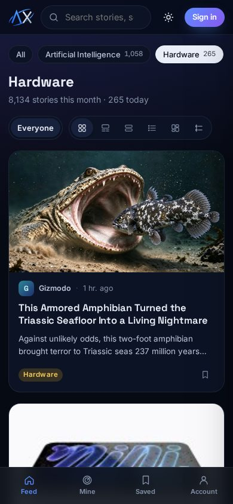
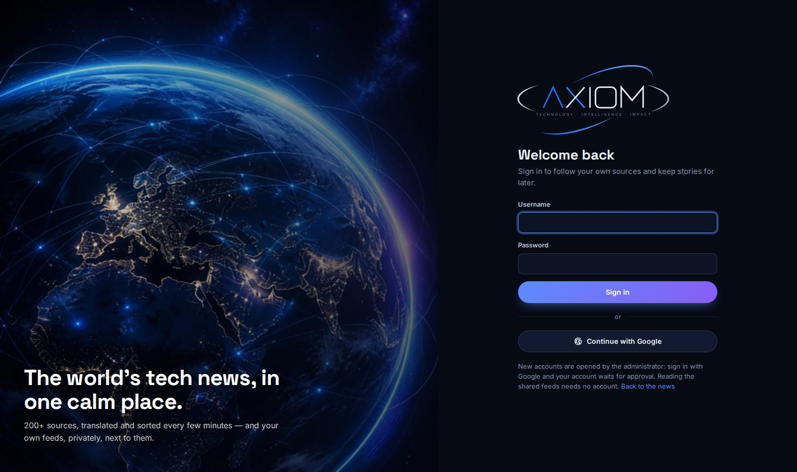
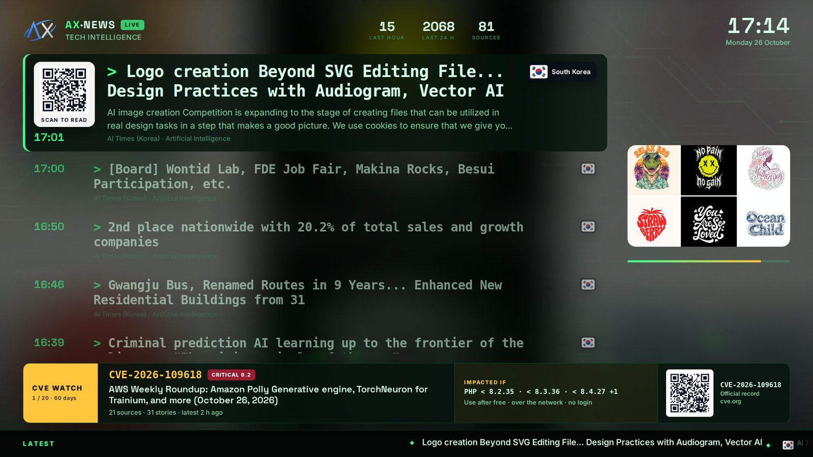
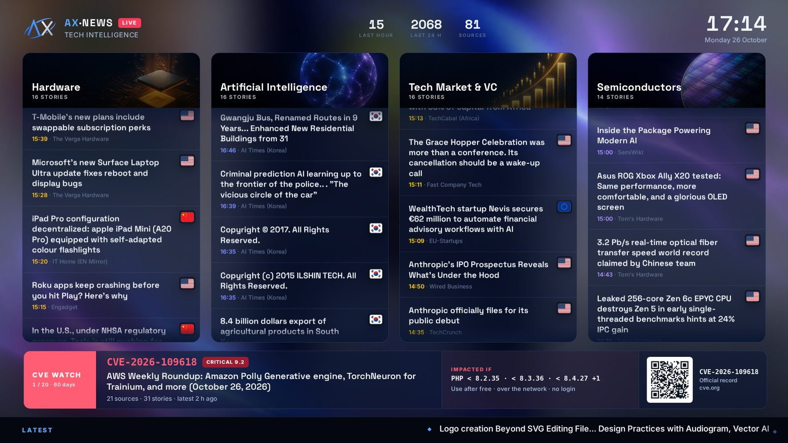

# AX-NEWS in pictures

Screenshots of [ax-news.com](https://ax-news.com) taken on 26 October 2026, at v1.3.0. The stories on them are that
day's real news. The account screens are from a demo account.
[Back to the README](../README.md)

## On the web

### The feed
The shared feed on one topic, Hardware, cards layout. Topics on the left, each with its story count. In the
right column: trending entities and the busiest sources.

The Semiconductors topic in the magazine layout, light theme. Cards, magazine, micro news, list, mosaic and timeline show the same stories.

The reader panel. It opens over the feed and moves with `j`/`k`. A story without a picture gets its topic's
illustration.

On a phone:

### Pages for search engines
A topic page, rendered on the server: the day's stories with each outlet's flag, the topic's days and RSS feed,
and links to the other topics.

A CVE page has four parts:
- **Impacted if**: products and versions, in broad lines;
- the kind of flaw and what an attacker needs;
- the severity, and CISA KEV when it applies;
- every story that quotes it.

The CVE watch shows breaking CVEs (first seen in the last hour, scored 8+), the 20 that mattered most in 60 days and
those in this week's news.

### Your account
The world feed catalog holds 844 checked feeds in 28 languages, sorted by field. Follow any of them in one click.
They come in English, whatever their language.

Setting up a TV screen means choosing:
- its title;
- what it shows: the shared feeds, your own sources, or both;
- the alert band;
- the layout, the theme and the topics.

The sign-in page:

## On a TV

Six layouts and six themes, made for 75–90" screens that run all day. Every story carries a QR code at its top left
to read it on a phone. The flag of the outlet's country is at its top right.

The band at the bottom is the **CVE watch**. It turns through the vulnerabilities that mattered most in the last 60
days. Each one shows its **Impacted if** and a QR code to its official record on cve.org. It can show the screen's
own keywords instead.

**Spotlight** shows one story full screen with what comes next. A breaking CVE takes the side column for its hour.

**Newsroom** shows a main story beside the live list.

**Wall** shows five tiles, one turning at a time.

This Wall screen keeps to two topics, Biotech & Medtech and Research Papers, in the Clinic theme.

**Magazine** is an editorial cover.

**Headlines** shows only big words, readable from across the room.

**Columns** gives one scrolling column per topic.

---

The interface is under the MIT licence; the stories, titles and pictures on these screenshots belong to their
publishers.
